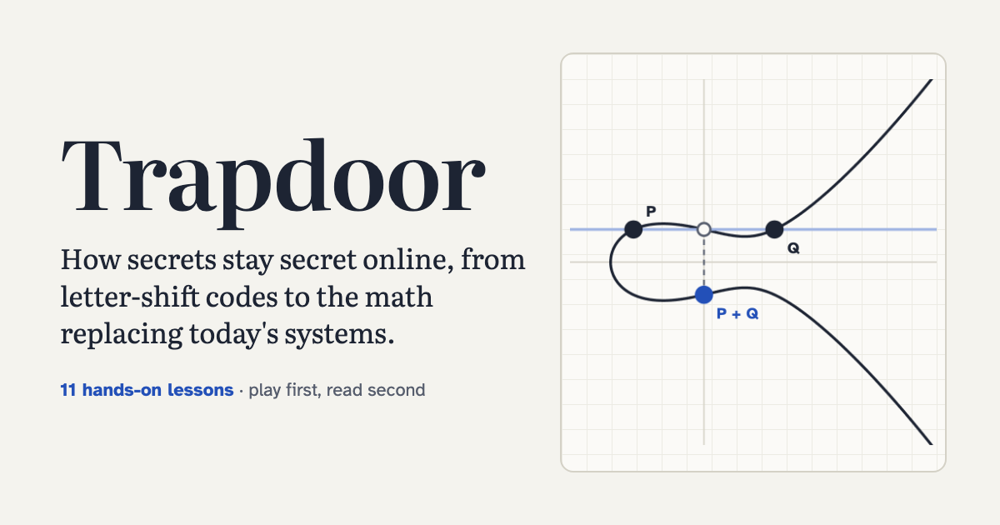

# Trapdoor



How secrets stay secret online, from letter-shift codes to the math that is replacing today's systems. Eleven short, hands-on lessons for high-school students: play first, read second.

**Live:** https://maninae.github.io/trapdoor/

## Chapters

| Part | # | Chapter | You get to |
|---|---|---|---|
| Shared secrets | 1 | Secret codes | Spin a cipher wheel, then crack a code by counting letters |
| | 2 | The blender | Flip bits with XOR and watch a SHA-256 fingerprint change |
| Strangers | 3 | Clock math | Wrap numbers around a clock and find a calculation that only runs one way |
| | 4 | A secret in plain sight | Agree on a secret while everyone listens (Diffie-Hellman) |
| | 5 | Two keys | Race to factor a number, then lock a message with RSA |
| | 6 | Signatures | Sign a message, tamper with it, and watch the check fail |
| Curves | 7 | Hopping on a curve | Add points on an elliptic curve and hunt for the hop count |
| After quantum | 8 | The rhythm finder | See the repeating rhythm a quantum computer would hear |
| | 9 | Lost in the grid | Find the nearest dot in a lattice with good and bad arrows |
| | 10 | Signatures from the blender | Sign with a one-time Lamport key, then leak it |
| | 11 | The big picture | Compare every family's key and signature sizes |

## Run locally

Plain HTML, CSS and JavaScript, no build step:

```bash
python3 -m http.server 8000
```

Then open http://localhost:8000/. Pages also open straight from disk.

## License

MIT, see [LICENSE](LICENSE).
